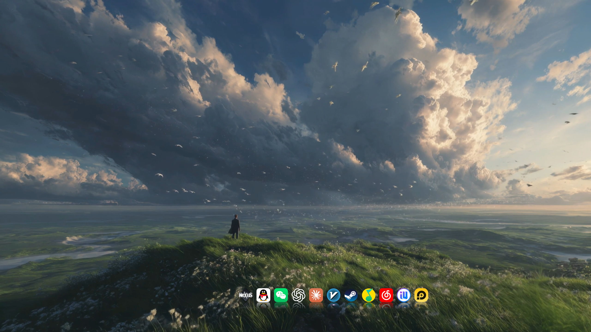

# Win11 动态桌面美化教程

动态壁纸 + 底部 Dock + 隐藏任务栏和桌面图标，打造一个干净的 Windows 11 桌面。
附带一键设置脚本、壁纸开机不出来的修复脚本，以及硬盘占用扫描脚本。



---

## 用到的软件

| 软件 | 作用 | 价格 | 获取方式 |
| --- | --- | --- | --- |
| [Wallpaper Engine](https://store.steampowered.com/app/431960/Wallpaper_Engine/) | 动态壁纸 | 付费（Steam） | Steam 商店 |
| [Winstep Nexus](https://www.winstep.net/nexus.htm) | 仿 macOS 的底部 Dock 栏 | 免费版够用 | 官网下载 |

> 本仓库不包含任何软件安装包或壁纸文件，请从上面的官方渠道获取。

---

## 第一步：安装 Wallpaper Engine，挑壁纸

1. 在 Steam 购买并安装 Wallpaper Engine。
2. 打开后点「创意工坊」，搜索喜欢的壁纸，点「订阅」就会自动下载。
3. 我自己在用的壁纸清单见 [wallpapers.md](wallpapers.md)（水墨、赛博朋克、火影、海贼王等）。

**推荐设置**（Wallpaper Engine 右上角齿轮 → 设置）：

- 「常规」→ 开机启动：**打开**，但**不要勾选「高优先级」**（原因见下方常见问题）。
- 「性能」→ 其他应用全屏时：选「暂停」，打游戏时不占显卡。

## 第二步：安装 Nexus Dock

1. 从 [Winstep 官网](https://www.winstep.net/nexus.htm) 下载 Nexus 并安装。
2. 把常用软件的快捷方式直接拖到 Dock 上。
3. 右键 Dock → Preferences，可以改主题、图标大小和放大效果。
4. 想让 Dock 开机自启：Preferences → General → 勾选「Launch Nexus at Windows startup」。

## 第三步：一键调整任务栏和桌面

用脚本自动完成下面这些设置：

- 任务栏和开始菜单用深色，打开透明效果
- 任务栏自动隐藏（鼠标移到屏幕底部才出现，Dock 来代替它）
- 隐藏桌面图标（壁纸不被挡住）
- 隐藏「任务视图」按钮

**运行方法：**

1. 下载本仓库：点页面上绿色的「Code」→「Download ZIP」，解压。
2. 在解压后的文件夹里，按住 Shift 右键空白处 →「在终端中打开」。
3. 输入下面的命令，回车：

```powershell
powershell -ExecutionPolicy Bypass -File .\scripts\apply-look.ps1
```

任务栏会闪一下，然后设置就生效了。脚本会先把你原来的设置备份到 `backup\` 文件夹。

**想恢复原样：**

```powershell
powershell -ExecutionPolicy Bypass -File .\scripts\apply-look.ps1 -Undo
```

> 桌面图标藏起来以后，想临时看一下：在桌面右键 →「查看」→ 勾选「显示桌面图标」。

---

## 常见问题

### 开机以后壁纸不出来，要手动打开 Wallpaper Engine

**原因：** 在 Wallpaper Engine 里勾选了「高优先级」后，它改成依赖一个后台服务来开机启动。
很多电脑管家或优化软件会把这个服务改成「手动」，或者把启动项关掉，结果开机时就没东西去启动它。

**解决：** 运行修复脚本，它会建一个「登录 10 秒后启动壁纸」的计划任务，不需要管理员权限：

```powershell
powershell -ExecutionPolicy Bypass -File .\scripts\fix-wallpaper-autostart.ps1
```

之后在 Wallpaper Engine 设置里**取消勾选「高优先级」**。想撤销这个修复：

```powershell
powershell -ExecutionPolicy Bypass -File .\scripts\fix-wallpaper-autostart.ps1 -Remove
```

### 美化以后找不到软件图标了

桌面图标被隐藏了。可以：

- 把常用软件拖到 Nexus Dock 上；
- 或者在开始菜单里找到软件，右键 →「固定到任务栏」。

### 动态壁纸会不会很卡、很费电？

视频类壁纸一般占用不高。如果笔记本用电池时想省电：Wallpaper Engine 设置 →「性能」→「使用电池时」选「暂停」。

### C 盘满了，想看看什么占地方

运行扫描脚本，它只列出大小，**不会删除任何文件**：

```powershell
powershell -ExecutionPolicy Bypass -File .\scripts\scan-disk.ps1
```

创意工坊壁纸订阅多了会很占空间，不用的壁纸在 Wallpaper Engine 里右键 →「取消订阅」就会删掉。

---

## 文件说明

```
├── README.md                         本教程
├── wallpapers.md                     壁纸推荐清单（创意工坊链接）
├── scripts/
│   ├── apply-look.ps1                一键调整任务栏和桌面
│   ├── fix-wallpaper-autostart.ps1   修复壁纸开机不自动启动
│   └── scan-disk.ps1                 扫描硬盘占用（只看不删）
└── docs/                             截图
```

## 适用环境

- Windows 11（Windows 10 大部分设置也能用，任务栏部分可能略有不同）
- Windows PowerShell 5.1（系统自带）

## 许可

脚本和教程采用 [MIT 许可](LICENSE)。壁纸版权归各自作者所有，本仓库只提供创意工坊链接。
